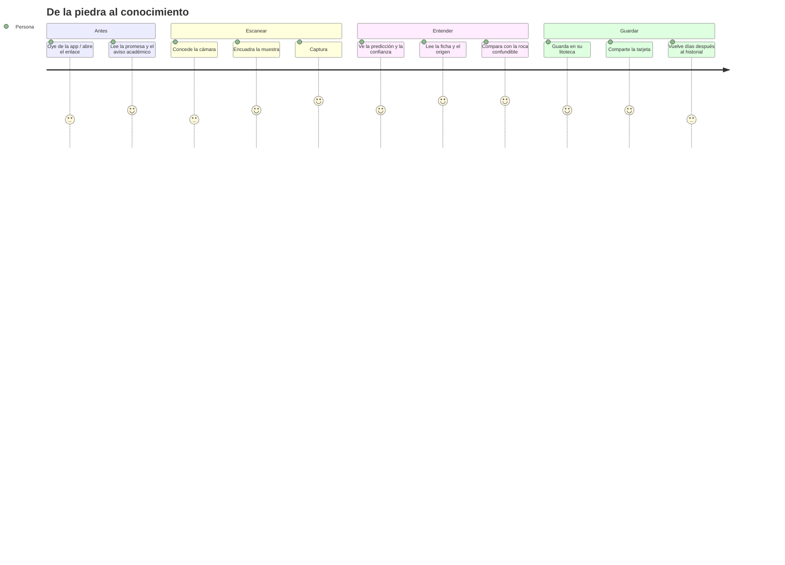
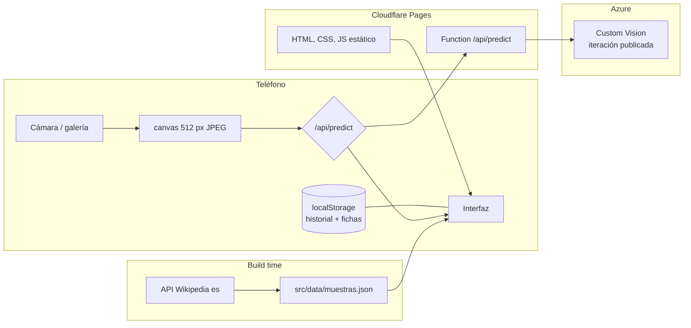

# Litoteca — Blueprint de servicio

> Clasificador de muestras de roca con la cámara del teléfono, más una capa de
> aprendizaje que explica *por qué* la piedra que tienes en la mano es lo que es.
> Documento de ideación (nov 2026). Nada de esto está implementado todavía: aquí
> quedan el nombre, el alcance, el blueprint y las fases.

---

## 0. Nombre

**Propuesta: `litoteca`** — repo `litoteca`, proyecto de Cloudflare Pages
`litoteca`, URL `litoteca.pages.dev`.

*Litoteca* es el término real con que se nombra una colección catalogada de
muestras de roca (el equivalente de una biblioteca, pero de piedras). Cumple lo
que buscamos: nombra el gesto del producto (clasificar y catalogar), implica
aprendizaje sin decirlo, es una sola palabra sin tildes ni guiones —igual que
`atmosferas` y `diagram-lab`— y funciona igual en español y en inglés.

Nombre visible de la app: **Litoteca**. Bajada: **“Abre la piedra que tienes en
la mano.”** Alternativa más seca para el hero: **“¿Qué piedra es esta?”**

| Alternativa | A favor | En contra |
|---|---|---|
| `afloramiento` | Metáfora perfecta: lo que estaba enterrado sale a la luz; término geológico de campo | Largo para repo y dominio; difícil de escribir en un video |
| `estratos` | Capas = capas de aprendizaje | Muy usado como nombre de producto genérico |
| `geolupa` | Cercano, amable, explica la función | Suena a juguete escolar, resta rigor ante un docente |
| `cantil` | Corto y sonoro | No comunica nada sin explicación |

Carpeta ya creada: `Personal/litoteca/`. Si se cambia el nombre, renombrar la
carpeta y el proyecto de Pages. Antes de publicar hay que verificar la
disponibilidad del dominio (`litoteca.app`, `litoteca.co`, `litoteca.dev`) y del
handle en GitHub; ninguna se ha comprobado todavía.

---

## 1. Contexto y encuadre académico

* **Actividad**: implementar un modelo de clasificación en visión por computador
  e integrarlo en una aplicación de uso real, con entrenamiento y despliegue en
  la nube.
* **Área de aplicación**: reconocimiento de objetos (clasificación de imagen
  única), aplicado a geología de campo y educación.
* **Relación con el trabajo del autor**: herramienta de bolsillo para salidas de
  campo y material didáctico; no es un producto comercial ni reemplaza el
  análisis petrográfico.
* **Plataforma**: Azure AI Custom Vision (créditos gratuitos ya disponibles).
  Modelo ya entrenado con las 9 clases del dataset.
* **Dónde vive cada cosa**:

| Pieza | Ruta |
|---|---|
| Dataset, notebooks, métricas | `~/Academic/Deriverables/ML/rock-classifier/` |
| Informe IEEE (LaTeX, texforge) | `~/Academic/Deriverables/ML/rock-classifier/` |
| App, API y despliegue | `~/Projects/Personal/litoteca/` (este repo) |
| Video demostrativo | `facet` (narración + montaje), subido a YouTube |

Criterios de desempeño y dónde se evidencian:

| Criterio | Evidencia |
|---|---|
| Contexto y área de aplicación | §1 y §2 de este documento → §1 del informe |
| Dataset seleccionado y preparado | §4 y §5 → §3 del informe, notebook de preparación |
| Entrenamiento y evaluación con métricas | §10 → §4 del informe (matriz de confusión, P/R/F1, ROC-AUC) |
| Interfaz amigable y funcional | §7, §8 y §12 → demo en video |
| Video claro y profesional | §14 |

---

## 2. La idea

**Una litoteca de bolsillo.** Apuntas la cámara a una roca, la app dice qué es,
de dónde viene y cómo se formó — y cuando duda, lo dice en vez de inventar.

Tres promesas, en orden:

1. **Identificar en segundos**, con la cámara trasera y sin instalar nada.
2. **Enseñar el porqué**: origen geológico, formación, dónde se encuentra, usos,
   dato curioso y las confusiones típicas con rocas parecidas.
3. **Ser honesta**: confianza visible, top-3 de candidatas, aviso explícito
   cuando el modelo no está seguro y recordatorio de que es orientación de campo,
   no diagnóstico de laboratorio.

Anti-objetivos (lo que la app **no** hace, y lo dice): no mide dureza, no
responde a ácido, no sustituye un análisis petrográfico, no identifica minerales
sueltos con fiabilidad.

**Por qué no es solo clasificar.** Un clasificador entrega una etiqueta; el
aprendizaje ocurre en la fricción: *¿en qué se diferencia este basalto de uno
olivínico?*, *¿por qué el modelo confundió chert con diatomita?*, *¿qué estaba
fuera del encuadre?*. La capa educativa convierte cada error en una ficha
comparativa. Ahí está el valor y también la defensa ante el docente.

---

## 3. Público y escenarios

| Público | Necesidad | Lo que obtiene |
|---|---|---|
| Estudiantes de geología, ambiental e ingeniería civil | Contrastar una muestra en campo o en el laboratorio | Predicción + ficha + enlace a Wikipedia; vocabulario técnico correcto |
| Aficionados y coleccionistas | Poner nombre a lo que recogieron | Nombre común y técnico, origen, foto compartible |
| Docentes de ciencias | Material de clase | Modo demostración, fichas y confusiones frecuentes |
| Público general curioso | Entender qué tiene en la mano | Lenguaje llano, sin jerga |

Escenarios:

* **Campo, con sol y una mano libre**: móvil, cámara trasera, una sola decisión
  por pantalla, botones grandes, alto contraste.
* **Laboratorio / clase**: sube una foto del archivo o proyecta el resultado.
* **Sin conexión en la montaña**: ve el historial y las fichas ya visitadas; la
  predicción requiere red (ver §13).
* **Colección en casa**: historial local como catálogo mínimo.

---

## 4. El dataset, sin adornos

Ruta local: `archive/Rock Data/` (export de clasificación de Roboflow, licencia
MIT). Estructura `train / valid / test`, una carpeta por clase.

| Clase (carpeta) | Nombre ES | Origen | Familia | train | valid | test |
|---|---|---|---|---|---|---|
| `Basalt` | Basalto | Ígnea (volcánica) | Máfica | 432 | 39 | 15 |
| `olivine-basalt` | Basalto olivínico | Ígnea (volcánica) | Máfica | 375 | 43 | 24 |
| `Clay` | Arcilla | Sedimentaria (detrítica) | Arcillolita | 453 | 32 | 15 |
| `Conglomerate` | Conglomerado | Sedimentaria (detrítica) | Rudita | 447 | 34 | 17 |
| `Shale-(Mudstone)` | Lutita | Sedimentaria (detrítica) | Pelita | 396 | 41 | 22 |
| `Diatomite` | Diatomita | Sedimentaria (biogénica) | Silícea | 405 | 40 | 23 |
| `chert` | Sílex (chert) | Sedimentaria (química) | Silícea | 405 | 45 | 15 |
| `Siliceous-sinter` | Sinter silíceo (geiserita) | Sedimentaria (hidrotermal) | Silícea | 381 | 38 | 16 |
| `gypsum` | Yeso | Sedimentaria (evaporítica) | Sulfato | 393 | 39 | 27 |
| **Total** | | | | **3.687** | **351** | **174** |

Tres hechos que condicionan el producto (y que el informe debe declarar):

1. **No hay clase metamórfica.** El brief inicial de frontend prometía ígnea /
   sedimentaria / metamórfica; el dataset solo cubre dos orígenes. La interfaz
   muestra dos colores y la ficha puede mencionar “qué se le parece en el ciclo
   de las rocas”, pero no se inventa un tercer origen.
2. **Hay pares casi gemelos.** `Basalt` ↔ `olivine-basalt` y
   `chert` ↔ `Diatomite` ↔ `Siliceous-sinter` son petrográficamente distinguibles
   solo con lupa o laboratorio. El modelo fallará ahí, y es *geológicamente
   esperable*. La app lo convierte en contenido (“estas tres son síliceas; se
   distinguen por textura y origen”) en vez de esconderlo.
3. **El split de test es diminuto** (174 imágenes, 15–27 por clase). Sirve como
   sanidad, no como base para ROC/AUC. La evaluación real se hace con un
   *hold-out estratificado propio* sacado de `train` (ver §10).

Nota de procedencia (resuelta): el `archive.zip` local coincide exactamente —
4.212 imágenes, mismas 9 clases, mismos `README.dataset.txt` y
`README.roboflow.txt`, 224 MB — con el dataset público de Kaggle
**`stealthtechnologies/rock-classification`** (licencia MIT), que a su vez es un
export de Roboflow (`universe.roboflow.com/william-cwsr-8jizi/rock-clasfication`).
Citar en el informe el dataset de Kaggle + el proyecto de Roboflow + fecha de
descarga, y **no** atribuirlo a un autor que no consta en los archivos.
Consecuencia práctica: los 4.212 incluyen ~3 versiones aumentadas por imagen
original (espejo, recorte, brillo), así que la diversidad real ronda las 1.400
imágenes distintas. Eso explica en parte las métricas altas y hay que declararlo.

### Dataset preparado (hecho)

La preparación ya está hecha en este repo con `tools/prepare_dataset.py`; el
detalle, los números y las decisiones están en [`DATASETS.md`](DATASETS.md).
Resumen de lo que cambió respecto al export original:

* Se agrupa por **imagen original**, no por archivo. El export tenía 89 originales
  repetidos entre `train` y `valid`, 43 entre `train` y `test`, 15 entre `valid`
  y `test`: el test no era externo. Ahora ningún original cae en dos splits.
* 4.212 archivos → 1.754 originales → **3.428 train / 209 valid / 146 test**.
  En `train` quedan todos los aumentos; en `valid` y `test`, un solo
  representante por original.
* 512×512 con recorte centrado, JPEG calidad 92, `manifest.csv` con procedencia
  y `dhash` por archivo.
* Se detectaron **22 pares con etiqueta contradictoria** (11 de ellos
  `chert` ↔ `diatomite`): ruido del dataset, no del modelo.

---

## 4.1 Datasets que se pueden mezclar

Revisión hecha el 20 nov 2026. La pregunta era si hay otros datasets para
combinar. Los hay, pero **mezclar no siempre mejora**: cambia la taxonomía y
puede romper las métricas del informe. Abajo qué existe, qué aporta y cuánto
cuesta usarlo.

| Dataset | Qué aporta | Clases | Volumen | Licencia | Veredicto |
|---|---|---|---|---|---|
| **Kaggle `stealthtechnologies/rock-classification`** | Es *el nuestro* | Las 9 | 4.212 | MIT | Fuente canónica a citar. No es un dataset nuevo |
| **Roboflow `microscopic imagedataset/rock-classification-tipeq`** | Copia del mismo set | Las 9 | 4.212 | CC BY 4.0 | Espejo por si Kaggle cae. Redundante |
| **Brac University Mars Rover** (Kaggle `salmaneunus/rock-classification`; espejo HF `udayl/rocks`) | Basalto extra de otra cámara + granito + **mármol y cuarcita** + carbón, caliza, arenisca | 7 | ~2.069 limpias (HF: 10.787 aumentadas) | Kaggle: “Other” (leer); HF: incierto — su card dice 7 clases pero el esquema trae 98 etiquetas | **Alta prioridad.** Fuente barata de metamórficas y de variedad de basalto |
| **Roboflow `fwe-lwnr5`** | Mapa de clases más completo: basalto, sílex, conglomerado, lutita, esquisto, granito, gneis, mármol, cuarcita, pizarra, filita, esquito azul, anfibolita, obsidiana, toba… | 53 | 2.200 (~41 por clase) | CC BY 4.0 | Excelente taxonomía, volumen fino. Sirve para *definir* clases nuevas, no para entrenar fuerte |
| **Roboflow “Mineral & Rock Dataset”** (Robiuls Workspace) | Basalto, granito, caliza, mármol, cuarcita, arenisca + minerales | 14 | ~2.990 | Roboflow (verificar) | Útil si se filtran las clases minerales; mezcla tareas |
| **PLOS One 2026, Figshare** (rock recognition dataset) | 10 clases con las tres familias: granito, basalto, arenisca, lutita, **anfibolita, filita**… | 10 | 3.190 | Verificar en Figshare (PLOS suele exigir CC BY) | Candidato fuerte para metamórficas de campo |
| **DCID — Drill Core Image Dataset** (Hugging Face) | Litologías en **núcleos de perforación** | 7 o 35 | 5.000/clase | CC BY-NC 4.0 | **No mezclar**: otro dominio (testigo de taladro, no mano). NC impide repo público. Útil como limitación declarada |
| **Sci Data 2025 (Nature)** | Fotomicrografías de lámina delgada | 105 tipos | 2.634 | CC BY 4.0 | Fuera de dominio: microscopio, no cámara de teléfono |
| **Phantom-fs, Applied Computing & Geosciences** | 19 tipos de campo en La Palma: basalto afanítico, vesicular, toba, andesita, escoria… | 19 | 950 (+aumento a 3.800) | Código MIT; el dataset **no** está en el repo | Interesante para realismo de campo, hay que pedirlo a los autores |
| **Bandirma / Brac 3 clases** (Roboflow) | Cajas de ígnea / metamórfica / sedimentaria | 3 | 1.197 | CC BY 4.0 | Solo si sobra tiempo: recortar cajas para usarlas como clasificación |

### Reglas para mezclar sin arruinar el proyecto

1. **Taxonomía canónica primero.** Cada imagen entra con un `id` del catálogo
   (`basalt`, `olivine-basalt`, …). Las etiquetas de otros datasets se mapean a
   ese `id`; lo que no mapee, no entra.
2. **No fusionar lo que hace valioso el proyecto.** `olivine-basalt` no se
   colapsa en `basalt`, ni `chert` en `flint` ni `shale` en `mudstone`. Si se
   fusionan, el modelo sube de exactitud y el producto pierde el sentido.
3. **Deduplicar por hash perceptual** antes de mezclar (el set base ya trae ~3
   aumentos por original) y verificar que el mismo original no quede en train y
   en test.
4. **Una fuente, una etiqueta de procedencia.** Guardar `fuente` por imagen para
   poder reportar métricas por dominio en el informe.
5. **Licencias en `DATASETS.md`**, con enlace y fecha. Nada NC ni “solo
   investigación” en un repo público. Verificar antes de descargar, no después.
6. **Ojo con los datasets sucios.** El espejo de Hugging Face del set de Brac
   declara 7 clases y su esquema expone 98 etiquetas: hay que auditar antes de
   confiar. Un dataset mal etiquetado cuesta más de lo que aporta.

### Tres caminos, con costo

| Camino | Qué implica | Costo | Riesgo |
|---|---|---|---|
| **A. Solo test externo** | No se reentrena: Brac/PLOS se usan como conjunto de **dominio cruzado** para medir cuánto generaliza el modelo a fotos de otra cámara y otro fondo | 1–2 h | Métricas bajas y hay que explicarlas; aun así es material excelente para el informe |
| **B. Ampliar las 9 clases** (recomendado) | Solo se suman imágenes a clases existentes —sobre todo `Basalt` desde Brac y PLOS— y se reentrena | 3–4 h + 1 iteración | Bajo: no cambia taxonomía, UI ni fichas |
| **C. Añadir metamórficas** | 4–6 clases nuevas (mármol, cuarcita, esquisto, gneis, pizarra, anfibolita) desde Brac, `fwe` y PLOS: reentrenar, 6 fichas nuevas, tercer color en la UI | ~2 días | Alto: se hace antes de congelar el modelo o no se hace |

Recomendación: **B ahora y A como figura del informe**; **C solo si el docente
valora explícitamente las tres familias**, y en ese caso decidirlo antes de la
fase 1, porque cambia el modelo, el contrato de la API y el diseño.

---

## 5. Ciclo del servicio (journey)



---

## 6. Blueprint de servicio

Etapas en columnas. Cada fila es una capa del servicio: lo que la persona ve,
quién actúa en escena, qué ocurre entre bastidores, qué sistema lo sostiene, qué
dato se genera y qué pasa cuando falla.

### 6.1 Etapa 0 — Llegada

| Capa | Detalle |
|---|---|
| Evidencia | Portada con una muestra recortada sobre papel mineral, título *Litoteca*, bajada, dos botones: **Abrir la cámara** / **Subir una foto**. Pie: “Demostración académica. No sustituye análisis de laboratorio.” |
| Acciones | Lee, decide, toca un botón |
| Frontstage | Una sola decisión por pantalla; sin registro, sin cookies, sin onboarding de 4 pasos |
| Backstage | Comprueba `navigator.mediaDevices` y contexto seguro; precarga el service worker y las fichas de las 9 clases (~30 KB) |
| Soporte | Cloudflare Pages (HTML/CSS/JS estático), Astro |
| Datos | Ninguno. Sin analítica de terceros en la v1 (o Cloudflare Web Analytics, sin cookies) |
| Falla | Sin cámara o sin HTTPS → la portada ofrece solo “Subir una foto”; sin JS → HTML estático con las 9 fichas legibles |

### 6.2 Etapa 1 — Permiso de cámara

| Capa | Detalle |
|---|---|
| Evidencia | Hoja del navegador pidiendo permiso; detrás, un marco de encuadre con una línea: “Buscamos la cámara trasera” |
| Acciones | Acepta o rechaza |
| Frontstage | Microcopy que explica *para qué* se pide (“la foto se analiza y se descarta”) |
| Backstage | `getUserMedia({ video: { facingMode: 'environment', width: 1280 } })`; si falla, cae a `facingMode: user` y luego a galería |
| Soporte | API del navegador; sin permisos en servidor |
| Datos | Ninguno persistido; la imagen vive en memoria |
| Falla | Denegado → pantalla con instrucciones por navegador + botón “Usar una foto del dispositivo”. Nunca un callejón sin salida |

### 6.3 Etapa 2 — Encuadre

| Capa | Detalle |
|---|---|
| Evidencia | Vídeo a pantalla completa, marco cuadrado, guía de tres viñetas: luz de frente, 20–30 cm, fondo neutro. Chip de origen si ya hay historial |
| Acciones | Mueve el teléfono, se acerca, busca luz |
| Frontstage | Guía discreta, sin bloquear la imagen; botón de linterna si el dispositivo lo soporta |
| Backstage | Muestreo opcional de luminancia del fotograma (canvas 64×64) para avisar “muy oscuro” antes de capturar |
| Soporte | `<video>` + `<canvas>` |
| Datos | Ninguno |
| Falla | Cámara muy oscura → aviso suave, no bloqueo |

### 6.4 Etapa 3 — Captura

| Capa | Detalle |
|---|---|
| Evidencia | Obturador grande, vibración háptica breve, flash blanco de 120 ms, miniatura que vuela a la tarjeta de resultado |
| Acciones | Un toque (o `Espacio` en teclado) |
| Frontstage | Modo manual. Ráfaga de 3 fotogramas separados 150 ms y promedio de probabilidades: reduce el ruido sin que se note |
| Backstage | Recorte cuadrado centrado → `canvas` a 512×512 → JPEG calidad 0.82 (~80–180 KB) → `POST /api/predict` |
| Soporte | Cloudflare Pages Function como proxy del modelo |
| Datos | La imagen **no se guarda** en servidor; solo la miniatura 96 px en `localStorage` |
| Falla | Timeout 8 s con un reintento; mensaje “no alcanzamos el modelo” + opción de reintentar con la foto del archivo |

### 6.5 Etapa 4 — Inferencia

| Capa | Detalle |
|---|---|
| Evidencia | Esqueleto de tarjeta con el nombre de la muestra difuminado, 600–1200 ms esperados; texto “Mirando la textura…” |
| Acciones | Espera (o sigue moviendo la piedra) |
| Frontstage | Progreso honesto: si pasa de 3 s, dice que está tardando en vez de girar para siempre |
| Backstage | Function valida tipo y tamaño, reenvía a Custom Vision con `Prediction-Key` en cabecera, normaliza la respuesta a nuestro contrato, aplica regla de margen (ver §10) |
| Soporte | Azure Custom Vision (endpoint de la iteración publicada), secreto en variable de entorno de Pages |
| Datos | Log mínimo: latencia, clase top-1, confianza (sin imagen, sin IP completa) |
| Falla | 503 del modelo → tarjeta de error con explicación y reintento; 413 → aviso de tamaño |

### 6.6 Etapa 5 — Resultado

| Capa | Detalle |
|---|---|
| Evidencia | Tarjeta que sube desde abajo (móvil) o panel derecho (escritorio): nombre común grande, nombre técnico en mono, chip de origen con color, barra de confianza, top-3 plegable |
| Acciones | Lee, decide si confía, toca “Ver ficha” |
| Frontstage | Confianza < 70 % → banda ámbar “Poco segura”. Margen top-1 − top-2 < 0.15 → “Puede ser X o Y” con ambas fichas. Nunca se muestra una sola etiqueta como verdad |
| Backstage | Mapeo clase → objeto de ficha desde `src/data/muestras.json` (generado en build) |
| Soporte | Datos estáticos versionados en el repo |
| Datos | Se registra el escaneo en `localStorage` (máx. 10, miniatura 96 px, fecha, confianza) |
| Falla | Clase sin ficha (modelo actualizado antes que los datos) → tarjeta básica con el nombre y enlace a Wikipedia |

### 6.7 Etapa 6 — Aprender

| Capa | Detalle |
|---|---|
| Evidencia | Ficha en secciones: **Qué es** · **Cómo se formó** · **Dónde se encuentra** · **Para qué se usa** · **Dato curioso** · **No la confundas con** · enlace “Leer más en Wikipedia” |
| Acciones | Lee, compara, responde 2 preguntas de comprobación |
| Frontstage | La sección “No la confundas” enlaza a la ficha de la roca gemela con un párrafo que explica *qué mirar*. El quiz es opcional, de 2 preguntas, y no bloquea nada |
| Backstage | Contenido curado a mano en `muestras.ts`; resumen de Wikipedia traído en build (§11) y cacheado |
| Soporte | API REST de Wikipedia (es), leída en tiempo de build |
| Datos | Respuestas del quiz solo en memoria; “guardar en mi litoteca” marca la muestra como propia |
| Falla | Wikipedia no responde en build → la ficha se publica sin extracto, con el enlace directo. La app nunca depende de la API en caliente |

### 6.8 Etapa 7 — Compartir

| Capa | Detalle |
|---|---|
| Evidencia | Botones **Escanear otra** · **Compartir** · **Mi litoteca** |
| Acciones | Comparte al chat o copia el texto |
| Frontstage | Tarjeta PNG generada en `canvas` (foto, nombre, origen, confianza, marca) + texto listo para WhatsApp |
| Backstage | `navigator.share` con archivo si está disponible; si no, descarga + copiar al portapapeles |
| Soporte | API del navegador |
| Datos | Nada sale del dispositivo salvo lo que la persona comparte |
| Falla | Sin `navigator.share` → descarga la imagen y muestra el texto seleccionable |

### 6.9 Etapa 8 — Volver

| Capa | Detalle |
|---|---|
| Evidencia | “Mi litoteca”: lista con miniatura, nombre, origen, fecha y confianza; botón borrar |
| Acciones | Reabre una ficha, borra una entrada, borra todo |
| Frontstage | Funciona sin conexión con las fichas ya visitadas |
| Backstage | `localStorage` (`litoteca.historial.v1`), máximo 10 entradas, poda FIFO, manejo de `QuotaExceededError` |
| Soporte | Service worker con estrategia *stale-while-revalidate* para fichas |
| Datos | Solo local. Sin cuenta, sin sincronización |
| Falla | Almacenamiento lleno → reduce miniaturas a 64 px antes de descartar entradas |

---

## 7. Pantallas

```text
┌───────────────────────────────┐   ┌───────────────────────────────┐
│  Litoteca                     │   │  ←  [ vídeo a pantalla ]      │
│                               │   │                               │
│   “Abre la piedra que         │   │      ┌───────────────┐        │
│    tienes en la mano.”        │   │      │   marco       │        │
│                               │   │      │   cuadrado    │        │
│   [ Abrir la cámara ]         │   │      └───────────────┘        │
│   [ Subir una foto ]          │   │   ☀ luz   ↔ 25 cm   ◐ fondo   │
│                               │   │                               │
│   Orientación de campo. No    │   │        (  escanear  )         │
│   sustituye el laboratorio.   │   │    🖼 galería    🔦 linterna   │
└───────────────────────────────┘   └───────────────────────────────┘

┌───────────────────────────────┐   ┌───────────────────────────────┐
│  ←        Resultado           │   │  ←  Mi litoteca               │
│  ┌─────────┐  BASALTO         │   │  ┌──┐ Basalto      12 nov 92% │
│  │  foto   │  Basalt         │   │  ├──┤ Sílex        12 nov 71% │
│  └─────────┘  ● Ígnea  92 %   │   │  ├──┤ Yeso         09 nov 88% │
│  ████████████████░░           │   │  └──┘                         │
│  ¿Puede ser basalto olivínico?│   │   [ borrar todo ]             │
│  [ Ver ficha ]  [ Compartir ] │   │                               │
└───────────────────────────────┘   └───────────────────────────────┘
```

Escritorio: dos columnas, vídeo a la izquierda y resultado a la derecha; la
tarjeta deja de ser hoja deslizante. Móvil: hoja deslizante con tirador, cierre
con gesto y con `Esc`.

---

## 8. La capa de aprendizaje (lo que la diferencia de un clasificador)

1. **Confianza visible y honesta.** Barra + top-3 + aviso por umbral. Enseña que
   un modelo probabilístico no es un oráculo.
2. **“No la confundas con”.** Cada ficha declara su gemela y el criterio de
   distinción (textura, brillo, porosidad, dureza). Es la traducción pedagógica
   de los errores reales de la matriz de confusión.
3. **Comprobación de dos preguntas.** “¿Dónde se forma?” / “¿Qué la distingue de
   X?”. Refuerzo, no evaluación; nunca bloquea el flujo.
4. **Bitácora de campo.** El historial no es una lista de capturas: es la
   colección de la persona, con fecha y confianza. Base para “¿qué muestras te
   faltan?”.
5. **Aviso metodológico permanente** en el pie de la ficha: modelo entrenado con
   N imágenes de 9 clases, exactitud del conjunto de evaluación, fecha de
   iteración. Transparencia como parte de la experiencia.

Fase 3 (opcional, si sobra tiempo): retos (“identifica 5 muestras distintas
hoy”), insignias y racha. No entran en la v1.

---

## 9. Diagrama de arquitectura



Repo:

```text
litoteca/
├── BLUEPRINT.md          ← este archivo
├── package.json
├── astro.config.mjs
├── functions/
│   └── api/
│       ├── predict.ts    ← proxy de Custom Vision
│       └── salud.ts
├── src/
│   ├── data/
│   │   ├── muestras.ts   ← clase, nombres, origen, ficha, gemelas
│   │   └── wiki.json     ← extractos cacheados en build + atribución
│   ├── components/       (Camara, Resultado, Ficha, Historial, Confianza)
│   ├── layouts/
│   ├── pages/
│   │   ├── index.astro
│   │   ├── escanear.astro
│   │   ├── muestra/[id].astro
│   │   └── litoteca.astro
│   ├── lib/              (recorte, inferencia, almacenamiento, compartir)
│   └── styles/
├── public/               (manifest.webmanifest, iconos, sw.js)
└── tools/
    ├── bajar_wiki.mjs    ← genera src/data/wiki.json
    └── capturar.sh       ← fotos de prueba para el video
```

---

## 10. Modelo, contrato de API y evaluación

### 10.1 Entrenamiento

* Custom Vision, proyecto **Classification / Multiclass**, dominio **Compact**
  (para poder exportar después).
* 9 tags, `train` local subido con sus etiquetas; iteración base con
  *Quick Training* y luego una iteración con *Advanced Training* (1 h) para
  comparar.
* Presupuesto: 1–2 iteraciones avanzadas dentro de los créditos gratuitos.
  Verificar que el recurso de Custom Vision siga activo antes de congelar la demo
  (el servicio tiene fecha de retiro anunciada; no apostar la entrega a una
  suscripción que puede expirar).

### 10.2 Contrato `POST /api/predict`

```http
POST /api/predict
Content-Type: multipart/form-data
campo: imagen  (JPEG/PNG/WebP, ≤ 4 MB, lado ≥ 256 px)
```

```json
{
  "modelo": { "iteracion": "rock-v2", "entrenado": "2026-11-18" },
  "predicciones": [
    { "id": "basalt", "nombre": "Basalto", "tecnico": "Basalt", "origen": "igneo", "p": 0.92 },
    { "id": "olivine-basalt", "nombre": "Basalto olivínico", "tecnico": "Olivine basalt", "origen": "igneo", "p": 0.05 },
    { "id": "chert", "nombre": "Sílex", "tecnico": "Chert", "origen": "sedimentario", "p": 0.01 }
  ],
  "top": "basalt",
  "confianza": 0.92,
  "margen": 0.87,
  "bajaConfianza": false,
  "ambiguo": false,
  "latenciaMs": 640
}
```

Errores: `400` imagen inválida · `413` demasiado grande · `429` límite de uso
(añadir en fase 2 con Turnstile o KV) · `503` modelo no disponible.

### 10.3 Reglas de presentación

| Condición | Presentación |
|---|---|
| `p₁ ≥ 0,70` y `p₁ − p₂ ≥ 0,15` | Resultado seguro, ficha completa |
| `p₁ ≥ 0,70` y margen `< 0,15` | “Puede ser X o Y”, dos fichas lado a lado |
| `p₁ < 0,70` | Banda ámbar “Poco segura”, se pide otra foto y se muestran las tres primeras |
| Ninguna clase supera 0,40 | “No reconozco esta muestra”; recomendar fondo neutro, luz y acercarse |

Umbrales provisionales: se fijan con la curva precisión–recall del conjunto de
evaluación, no a ojo. Quedan documentados en el informe.

### 10.4 Evaluación (lo que exige el criterio 3)

La consola de Custom Vision da precisión, recall y AP por etiqueta, pero **no**
curvas ROC ni AUC. Plan:

1. Exportar la iteración a **TensorFlow** (o TFJS) desde Custom Vision.
2. `tools/evaluar.py` en `rock-classifier`: corre el modelo exportado sobre
   `data/prepared/valid` (209 originales, para fijar umbrales) y sobre
   `data/prepared/test` (146 originales, nunca vistos) como prueba externa.
3. Calcula con `scikit-learn`: matriz de confusión, precisión/recall/F1 por clase,
   F1 macro y balanceado, exactitud top-1 y top-2, ROC one-vs-rest por clase y
   AUC macro/micro, y curva precisión–recall macro.
4. Genera figuras (PNG) y un `metricas.json` que alimenta el informe y la sección
   de transparencia de la app.

Advertencia que va en el informe: con 146 originales de test, un AUC de 0,99 no
es evidencia de nada; los intervalos de confianza son anchos. Lo que se defiende
es que los originales de test **no** aparecen en `train` (el export original sí
los mezclaba) y que la matriz de confusión se lee junto al ruido de etiquetado
documentado en `DATASETS.md`.

---

## 11. Enriquecimiento con Wikipedia

Mismo patrón que el periódico de `univerlab`, pero **en build, no en caliente**:

* `https://es.wikipedia.org/api/rest_v1/page/summary/{titulo}` → `extract`
  (texto plano), `content_urls.desktop.page`, `thumbnail`.
* `tools/bajar_wiki.mjs` recorre el mapeo de clases, guarda `src/data/wiki.json`
  y falla el build si una entrada no trae extracto (para que nadie publique una
  ficha vacía sin enterarse).
* La app nunca llama a Wikipedia en el navegador: cero latencia, cero CORS, cero
  riesgo de rate limit durante la demo.
* **Atribución obligatoria**: cada extracto lleva “Fuente: Wikipedia (CC BY-SA
  4.0)” con enlace a la página y a la licencia. Es requisito legal, no cortesía.
* El extracto es complemento, no sustituto: la ficha curada manda; Wikipedia
  aporta profundidad y el enlace.

Mapeo propuesto (verificar cada título al construir; si no existe en `es`, se
usa el equivalente en `en` y se declara idioma):

| Clase | Título es |
|---|---|
| `Basalt` | Basalto |
| `olivine-basalt` | Basalto olivínico → fallback `Basalto` |
| `Clay` | Arcilla |
| `Conglomerate` | Conglomerado (geología) |
| `Shale-(Mudstone)` | Lutita |
| `Diatomite` | Diatomita |
| `chert` | Sílex |
| `Siliceous-sinter` | Geiserita |
| `gypsum` | Yeso |

---

## 12. Sistema visual

Temática mineralógica, no “app de ciencia ficción”.

```css
:root {
  --papel:        #f7f4ee;  /* fondo, papel de cuaderno de campo */
  --papel-2:      #efeae0;
  --tinta:        #1b1a17;
  --tinta-2:      #57534b;
  --tinta-3:      #8b857a;
  --igneo:        #c2410c;  /* naranja-rojo: basalto, lava */
  --igneo-suave:  #fbe6da;
  --sedimentario: #a16207;  /* ocre: estratos, arena */
  --sedimentario-suave: #f7ecd2;
  --alerta:       #b45309;  /* banda de baja confianza */
  --ok:           #3f6212;
}
```

* **Tipografía**: display serif para el nombre de la muestra (Newsreader o
  Instrument Serif, igual que `atmosferas`); Inter para la interfaz; IBM Plex
  Mono para el nombre técnico, la confianza y la fecha de iteración.
* **Componentes**: tarjeta de resultado, barra de confianza, chip de origen,
  bloque de ficha con filete fino, tarjeta compartible, hoja deslizante.
* **Prohibido**: glassmorphism, gradientes de UI, sombras difusas, más de un
  acento por pantalla, iconografía de “IA” (cerebros, circuitos), emojis como
  iconos.
* **Accesibilidad**: contraste AA, foco visible, navegación completa por teclado,
  resultado anunciado en región `aria-live="polite"`, `alt` en miniaturas,
  botones ≥ 44 px, respeto a `prefers-reduced-motion`.
* **Presupuesto**: primera carga < 150 KB de JS; LCP < 2 s en 4G; Lighthouse
  ≥ 95 en accesibilidad y buenas prácticas.

---

## 13. PWA y modo sin conexión, sin mentiras

La predicción vive en la nube: **sin red no hay inferencia**. Lo que sí se
promete sin conexión: la app abre, el historial se lee y las fichas visitadas se
cargan del cache. El estado sin conexión se avisa con una banda explícita y el
botón de escanear se desactiva explicando por qué.

Alternativa futura (fase 4, no ahora): exportar a TensorFlow.js y correr el modelo
en el dispositivo. Implica ~5 MB de pesos y latencia variable en móviles
modestos; se evalúa solo si la demo lo necesita.

---

## 14. Entregables académicos

### 14.1 Informe IEEE

* Herramienta: `texforge` (proyecto en `rock-classifier`, plantilla IEEE,
  compilar con `texforge build`).
* Estructura: introducción y contexto → área de aplicación → dataset y
  preparación → metodología (Custom Vision, iteraciones, arquitectura) →
  resultados (métricas, figuras, matriz de confusión, tiempos) → discusión
  (limitaciones del dataset, confusión esperable) → conclusiones → referencias
  (dataset, Custom Vision, Wikipedia/CC BY-SA, marco de evaluación).
* Cada figura sale del `metricas.json`; ninguna cifra se escribe a mano en el
  texto sin trazabilidad al script.
* Declarar explícitamente: ausencia de clase metamórfica, tamaño del test,
  procedencia del dataset y que la app no reemplaza análisis de laboratorio.

### 14.2 Video (≤ 10 min)

Montaje con `facet`: narración con `kokoro.speak` (español), subtítulos con
`whisper-subs`, mezcla con `ffmpeg`, y captura de la app a pantalla completa.
Guion por bloques:

| Tiempo | Bloque | Qué se ve |
|---|---|---|
| 0:00–0:40 | Gancho | Mano con una piedra, primera predicción en el móvil |
| 0:40–1:40 | Contexto y área | Quién lo usa, por qué geología de campo, aviso académico |
| 1:40–3:00 | Dataset | Carpetas, conteos, las 9 clases, problemas detectados |
| 3:00–5:00 | Entrenamiento | Consola de Custom Vision, iteraciones, ajustes |
| 5:00–7:00 | Evaluación | Matriz de confusión, P/R/F1, ROC-AUC, qué falla y por qué |
| 7:00–9:00 | Demo | Cámara, resultado, ficha, gemelas, historial, compartir, error en vivo |
| 9:00–9:45 | Cierre | Aprendizajes, limitaciones, siguiente paso |

Regla: mostrar **un error real** del modelo en cámara. Vale más que diez aciertos.

---

## 15. Fases y checkpoints

| # | Fase | Entregable | Checkpoint |
|---|---|---|---|
| 0 | Modelo y datos | Dataset preparado (hecho, ver `DATASETS.md`) + iteración publicada + `metricas.json` + figuras + prueba de dominio cruzado (Brac/PLOS) | Revisar métricas antes de tocar la app |
| 1 | Esqueleto | Repo, Astro, portada, `/escanear` con cámara real, `functions/api/predict.ts` con el modelo real | Preview en `litoteca.pages.dev` haciendo una predicción end-to-end |
| 2 | Resultado y ficha | Tarjeta, umbrales, top-3, fichas curadas, Wikipedia en build | Revisar las 9 fichas y la atribución |
| 3 | Aprendizaje y memoria | “No la confundas”, quiz, historial, compartir, PWA | Prueba en móvil real, con dedo y con sol |
| 4 | Cierre académico | Informe IEEE en PDF + video de 10 min + entrega | Repaso de los 5 criterios |

Parar en cada checkpoint y mostrar el resultado antes de seguir.

---

## 16. Riesgos

| Riesgo | Impacto | Mitigación |
|---|---|---|
| Custom Vision deja de estar disponible (retiro anunciado) | Se cae la demo | Exportar la iteración a TensorFlow/TFJS apenas esté aprobada; el proxy permite cambiar de backend sin tocar la UI |
| Pares de clases indistinguibles (`basalt` / `olivine-basalt`) | Métricas “malas” y usuarios confundidos | Regla de margen, fichas de confusión, discusión honesta en el informe |
| Test de 174 imágenes | Métricas poco defendibles | Hold-out propio estratificado + intervalos de confianza en el informe |
| Iluminación y fondo en campo | Predicciones erradas | Guía de encuadre, promedio de 3 fotogramas, mensaje claro de baja confianza |
| Derechos del dataset y de Wikipedia | Riesgo legal en la entrega | Licencia MIT del export, cita del autor original, atribución CC BY-SA visible |
| `localStorage` lleno con miniaturas | Historial corrupto | Miniaturas 96 px, poda FIFO, manejo de cuota |
| Permiso de cámara denegado en la demo | Video sin demo | Ruta de galería siempre disponible; probar en dos navegadores |

---

## 17. Fuera de alcance (v1)

Cuentas de usuario, base de datos, sincronización entre dispositivos, mapa de
afloramientos, medición de dureza o efervescencia, identificación de minerales
sueltos, clases metamórficas nuevas, inferencia offline, i18n inglés, retos e
insignias, analítica de terceros con cookies.

---

## 18. Preguntas abiertas

1. ¿Se queda `litoteca` o se prefiere `afloramiento`? (Decide carpeta, Pages y
   dominio.)
2. ¿Se amplía el dataset con rocas metamórficas para completar los tres orígenes
   (Brac: mármol y cuarcita; `fwe` y PLOS: esquisto, gneis, pizarra, anfibolita),
   o se asume el alcance de dos y se explica? Decidirlo antes de la fase 1.
3. ¿El quiz y la bitácora entran en la v1 o quedan como “próximo paso” del video?
4. ¿Dominio propio (`litoteca.app`) o basta `litoteca.pages.dev` para la entrega?
5. ¿Se publica el repo en GitHub con el informe y los notebooks enlazados?
